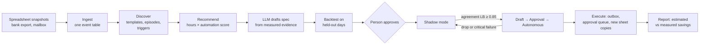

# ShadowCost

**ShadowCost finds repetitive spreadsheet and email work in small companies,
drafts an agent for each workflow, and makes the agent prove itself in shadow
mode against what the person actually did before it gets any autonomy.**

> Enterprise platforms such as Celonis and UiPath are moving toward
> discover-and-automate. ShadowCost targets the gap for smaller companies:
> agents that prove themselves against real human work before they get autonomy.

```
upload → discover → recommend → generate spec → test → approve → shadow → promote → execute → report
```

## What makes it different

- **Shadow mode before autonomy.** Each agent runs silently alongside the person
  and every case is compared with what the person actually did. It earns
  autonomy in stages (draft only, then act with approval, then act alone) and
  only when the 95% lower bound of its agreement clears 0.85 over at least 30
  cases. A lucky streak isn't enough, and agents are demoted when agreement drops.
- **Works without enterprise event logs.** Workflows are inferred from what
  small companies already have: dated spreadsheet copies, a bank export and a
  mailbox.
- **Measured, not just estimated.** Every time estimate lists its assumptions,
  and the report puts it next to the time actually spent.

## Results

All numbers come from a simulated company with a hidden ground-truth log of
every action. Tuning used separate seeds, and the committed sample was held out.

| Step | Result |
|---|---|
| Ingest | Spreadsheet edits recovered with precision and recall 1.0; 80/80 payments and 180/180 emails linked to the right invoice |
| Discover | Precision and recall 1.00 on workflows; the chasing rule ("Mondays and Thursdays, due date ≥ 7 days ago, unpaid") recovered from the data alone |
| Spec (LLM) | On held-out days the LLM-drafted specs agree with the person 100% / 77.8% / 77.8%, matching specs written from the simulator's real rules (100% / 77.8% / 76.7%) |
| Shadow mode (1 year) | Invoice and payment agents reach autonomy by July; the chasing agent stays in shadow at 67%, because chasing needs judgment |
| Savings | 40.9 h estimated from stated assumptions; 47.7 h measured from the person's actual minutes |

Where it falls short is written down too: [discovery](docs/discovery.md#known-limitations)
and [agents](docs/agents.md#limitations).

## How it works



| Module | What it does |
|---|---|
| `synth` | Simulates a small company (invoicing, payments, chasing), with a deliberately imperfect office manager and a hidden ground-truth log |
| `ingest` | Classifies files from names and headers, diffs snapshots row by row, links payments and emails to the invoice they're about |
| `discover` | Clusters emails into templates, groups work into episodes, infers triggers (event, new row, weekday schedule with a binomial test) and date conditions |
| `recommend` | Ranks workflows by addressable hours, with every assumption stated |
| `agent` | An LLM (Groq) drafts a spec as data; a deterministic engine runs it; expressions are whitelisted so specs can't run code; backtest, approval and shadow mode |
| `execute` | Acts as the stage allows: drafts, an approval queue, or an outbox and new sheet copies. Never sends or overwrites directly |
| `report` | Markdown/HTML savings report with estimated and measured figures |
| `api`, `app/` | FastAPI service and Streamlit UI over the whole flow |

More detail: [architecture](docs/architecture.md), [discovery method](docs/discovery.md),
[agents](docs/agents.md), [roadmap](docs/roadmap.md).

## Quickstart

Requires Python 3.11+.

```bash
python -m venv .venv
source .venv/Scripts/activate        # Windows Git Bash; .venv/bin/activate on macOS/Linux
pip install -e ".[dev,app]"
pytest
```

Run the web app:

```bash
streamlit run app/streamlit_app.py
```

Or follow the flow from the command line:

```bash
shadowcost-ingest data/sample                        # what's in the files
shadowcost-discover data/sample --evaluate           # repeated work, scored against ground truth
cp .env.example .env                                 # add GROQ_API_KEY (free tier) to draft new specs
shadowcost-agent generate data/sample --out specs    # LLM drafts + held-out backtests
shadowcost-agent approve specs/W1.json --by "<name>" # nothing runs unapproved
shadowcost-synth --out data/demo-year --days 365     # a year of data for shadow mode
shadowcost-agent shadow specs/W1.json data/demo-year # watch it earn autonomy
shadowcost-agent execute specs/W1.json data/demo-year --day 2026-08-03
shadowcost-report data/demo-year --out report.html
```

The bundled `specs/` were drafted by `openai/gpt-oss-120b` from the sample's
first 80 days, so the app and CLI work without an API key.

The API (`uvicorn shadowcost.api:app`) exposes the same flow: upload a zip,
list workflows, backtest, approve, shadow and report. Its docs are at `/docs`.

## Deploy

See [docs/deploy.md](docs/deploy.md) for Streamlit Community Cloud (free), Docker
and the API.

## Repository layout

```
src/shadowcost/   library: synth, ingest, discover, recommend, agent, execute, report, api
app/              Streamlit UI
specs/            agent specs drafted by the LLM for the sample, with backtest results
data/sample/      4-month synthetic dataset with data card and ground truth
docs/             architecture, method write-ups, deploy guide, demo script
tests/            pytest suite (no network: the LLM is faked)
```

## License

MIT
