# Architecture

## Pipeline

```mermaid
flowchart LR
    subgraph Inputs
        A1[CSV / Excel files]
        A2[File snapshots]
        A3[Email-style records]
    end

    Inputs --> U[Upload & normalize]
    U --> D[Discover<br/>repetitive workflows]
    D --> R[Recommend<br/>rank by measured cost]
    R --> S[Generate agent spec]
    S --> T[Test on historical cases]
    T --> AP{Human approves?}
    AP -- no --> S
    AP -- yes --> SH[Shadow mode<br/>agent runs silently]

    SH --> C[Compare with<br/>what the human did]
    C --> L{Autonomy ladder}
    L -- promote --> DR[Draft] --> AA[Act with approval] --> AU[Act alone]
    L -- demote --> SH

    AU --> X[Execute]
    AA --> X
    X --> REP[Report<br/>measured savings + assumptions]
    C --> REP
```

## Components

Each pipeline stage is its own module under `src/shadowcost/`. Modules that
exist today are marked ✅.

| Stage | Module | Responsibility |
|---|---|---|
| (Test data) | `synth` ✅ | Simulates a small company's invoicing work and writes the files ShadowCost would receive, plus a hidden ground-truth log of every action, its workflow and the minutes it took. |
| Upload | `ingest` ✅ | Classify uploaded files from names and headers, diff spreadsheet snapshots row by row, and link bank payments and emails to the spreadsheet row (case) they're about. Output: one event table (schema in `ingest/events.py`). |
| Discover | `discover` ✅ | Cluster sent emails into templates, group work into per-case daily episodes, merge similar episode signatures into workflows, and infer each one's trigger (outside event, new row or weekly schedule) and date condition. See [discovery.md](discovery.md). |
| Recommend | `recommend` ✅ | Rank workflows by addressable hours: estimated time cost × regularity × consistency. Every estimate lists its assumptions, with an upper bound observed from email gaps. |
| (Grading) | `evaluation` ✅ | Scores discovery against a synthetic dataset's ground truth; the only code that reads `ground_truth/`. |
| Shadow | `shadow` ✅ | Compare the agent's output with the human's, field by field, with tolerance for numbers, case and whitespace. |
| Promote | `autonomy` ✅ | Shadow → draft → approval → autonomous. Promotion requires the Wilson lower bound of agreement to clear a threshold; demotion happens on an agreement drop or a critical failure. |
| Spec + test | `agent` ✅ | An LLM drafts a spec (trigger + rules, as data) from measured evidence; drafts are validated, repaired against the evidence period, and backtested on held-out days. See [agents.md](agents.md). |
| Approve + shadow | `agent` ✅ | Approval is stored against the spec's content hash; shadow mode replays outcomes through the autonomy ladder and records every outcome and stage change in SQLite. |
| Execute | `execute` ✅ | Carry out a day's proposals as the stage allows: log (shadow), `.eml` drafts and suggested cell changes (draft), an approval queue (approval), or emails to an outbox and a new copy of the sheet (autonomous). Nothing is sent or overwritten directly. |
| Report | `report` ✅ | Markdown/HTML report: work found, each agent's path up the ladder, savings estimated from stated assumptions and measured from the person's actual minutes, and every assumption. |

| UI + API | `app/`, `api` ✅ | Streamlit app and FastAPI service over the whole flow; see [deploy.md](deploy.md). |

## Design decisions

- **Evidence resets at each stage.** Agreement observed in shadow mode doesn't
  count toward promotion out of draft. Each stage has to earn its own evidence,
  because the agent's real-world effect changes at each step.
- **Lower bound, not point estimate.** 10/10 agreement gives a Wilson lower
  bound of about 0.72, which is not enough to promote. With the default bar of
  0.85, a perfect record needs about 30 cases.
- **Ingest infers, it never assumes a layout.** Snapshot series are found by
  dated file names, the row key by uniqueness across every snapshot (preferring
  id-like column names), and bank and email fields by header keywords. Values
  are compared as saved text, so a diff never comes from float or date parsing.
- **Linking prefers no answer over a wrong answer.** A payment reference must
  resolve to exactly one case. Without one, a payment is matched on exact amount
  only if the payer name also resembles the customer, and same-amount ties need
  a clear winner. Emails link by an unambiguous id mention, then by thread.
- **Agreement is all-or-nothing per case.** A case counts as agreement only if
  every compared field matched. A per-field score is kept for diagnostics.
