# Architecture

## Pipeline

```mermaid
flowchart LR
    subgraph Inputs
        A1[CSV / Excel files]
        A2[File snapshots]
        A3[Email-style records]
    end

    Inputs --> U[Upload & normalize]
    U --> D[Discover<br/>repetitive workflows]
    D --> R[Recommend<br/>rank by measured cost]
    R --> S[Generate agent spec]
    S --> T[Test on historical cases]
    T --> AP{Human approves?}
    AP -- no --> S
    AP -- yes --> SH[Shadow mode<br/>agent runs silently]

    SH --> C[Compare with<br/>what the human did]
    C --> L{Autonomy ladder}
    L -- promote --> DR[Draft] --> AA[Act with approval] --> AU[Act alone]
    L -- demote --> SH

    AU --> X[Execute]
    AA --> X
    X --> REP[Report<br/>measured savings + assumptions]
    C --> REP
```

## Components

Each pipeline stage is its own module under `src/shadowcost/`. Modules that
exist today are marked ✅.

| Stage | Module | Responsibility |
|---|---|---|
| (Test data) | `synth` ✅ | Simulates a small company's invoicing work and writes the files ShadowCost would receive, plus a hidden ground-truth log of every action, its workflow and the minutes it took. |
| Upload | `ingest` | Load CSV/Excel, file snapshots and email records into one event table: `case_id, actor, action, timestamp, payload`. |
| Discover | `discover` | Infer repeated workflows from the event table: recurring action sequences, column-level edit patterns between snapshots, templated emails. |
| Recommend | `recommend` | Rank candidate workflows by frequency × time per case. Every estimate lists its assumptions. |
| Generate spec | `spec` | Turn a workflow into an agent spec: inputs, steps, outputs and the fields to compare in shadow mode. |
| Test | `spec` | Replay the spec against historical cases before anyone approves it. |
| Shadow | `shadow` ✅ | Compare the agent's output with the human's, field by field, with tolerance for numbers, case and whitespace. |
| Promote | `autonomy` ✅ | Shadow → draft → approval → autonomous. Promotion requires the Wilson lower bound of agreement to clear a threshold; demotion happens on an agreement drop or a critical failure. |
| Execute | `execute` | Carry out the agent's actions at its current stage (draft, request approval or act). |
| Report | `report` | Savings measured from execution data: time saved per case, agreement rates, and cases where a human had to step in. |

## Design decisions

- **Evidence resets at each stage.** Agreement observed in shadow mode doesn't
  count toward promotion out of draft. Each stage has to earn its own evidence,
  because the agent's real-world effect changes at each step.
- **Lower bound, not point estimate.** 10/10 agreement gives a Wilson lower
  bound of about 0.72, which is not enough to promote. With the default bar of
  0.85, a perfect record needs about 30 cases.
- **Agreement is all-or-nothing per case.** A case counts as agreement only if
  every compared field matched. A per-field score is kept for diagnostics.
